# Boxes & Bytes · Frame Ops

**Learn C by watching it run.** Two visual, interactive courses that take a complete beginner from `scanf` to binary search trees, built for C programming finals.

| | Part | Guide | Live link |
|---|---|---|---|
| 🐱 | **Boxes & Bytes**: C basics | Mochi the cat | **https://meherabhs.github.io/boxes-and-bytes/** |
| 🤖 | **Frame Ops**: data structures | KESTREL, a mecha pilot unit | **https://meherabhs.github.io/boxes-and-bytes/frame-ops.html** |

No install, no sign-up and no build step. It works on a laptop or a phone. Each part has a button in its top bar that jumps to the other.

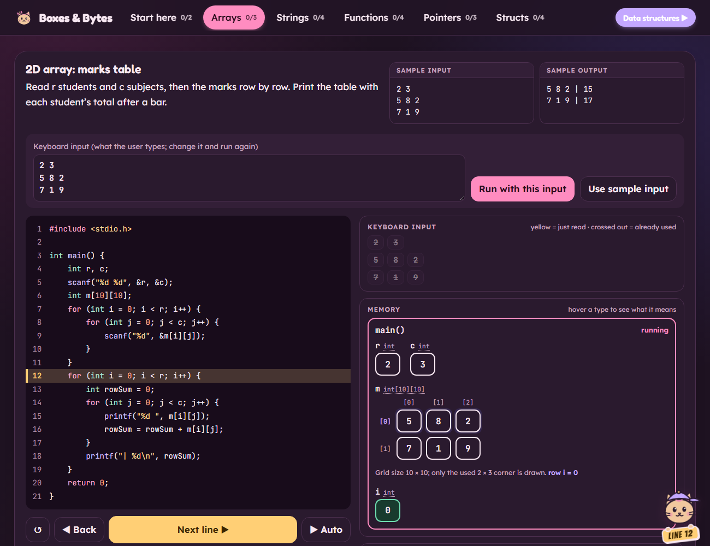

---

## Why I built this

I was teaching C to a newbie who had finals coming up, and the usual materials kept failing in the same places:

- **Code is invisible.** A slide shows `int marks[5];` or `head = head->next;`, but a beginner can't *see* what changed in memory. Most confusion about arrays, strings, pointers and linked lists comes from that missing picture.
- **Explanations come in big chunks.** Textbooks explain a whole program at once. A beginner needs to know what *this* line does, with *these* values, right now.
- **Our labs follow one fixed format.** Every lab problem is a task with a **Sample Input** and a **Sample Output**. Generic tutorials don't practise that format, so students never learn to check their output against the sample.
- **Theory and code live in different places.** Data structures need definitions, comparison tables, diagrams and exam-style theory answers. They also need code that actually runs. Students had to stitch these together from different sources.
- **The same exam mistakes keep coming back.** Off-by-one loops, a missing `&` in `scanf`, comparing strings with `==`, forgetting the base case, using a pointer after `free`.
- **Beginners lose motivation.** Dry pages get closed. A friendly guide who reacts to what you do keeps people going.

So I built two courses where every program can be run **one line at a time**, with memory drawn on screen as it changes.

## How it solves those problems

| Problem | What the site does |
|---|---|
| You can't see memory | Every variable is drawn as a labelled box. Arrays become lockers numbered from 0, 2D arrays become grids with the current row and column highlighted, strings become letter tiles showing ASCII codes and a red `\0` STOP tile. Pointers show addresses and arrows, and each function call gets its own stacked "room". In Frame Ops, every heap node is drawn with its address and its `next`/`prev`/`left`/`right` fields, connected by arrows. |
| Explanations come in big chunks | Press **Next line** and the current line is highlighted. The explanation shows what the line means in general *and* what it is doing with the actual values right now, e.g. "`total + runs[2]` → `57 + 7` → `64`". Every program also has an **Every line, explained** table. |
| Our labs use Sample Input / Output | Every program and exercise is a lab sheet with a task, Sample Input and Sample Output. Students can edit the keyboard input and run again. When the run ends, the page says whether the screen matches the Sample Output exactly. |
| Theory and code are separate | Each data structure has an **Intel** section: definitions, comparison tables (array vs linked list, stack vs queue …), step-by-step storyboards drawn with the same node diagrams, applications, pros and cons, plus **pseudocode with a meaning for every line and its Big-O cost**. |
| Exam mistakes | Every lesson has an **Exam traps** box. Many exercises are built around those traps, such as `<` vs `<=`, the missing `&`, and the missing `rear = NULL`. |
| Exam theory questions | Frame Ops has **36 short-answer theory questions with model answers**, for example "Differentiate array and linked list", "Why a circular queue?" and "Delete a node with two children". |
| Motivation | Mochi rolls across the screen, wears a different outfit in each lesson, holds up the current line number and does a happy dance when a lesson's labs are all solved. KESTREL launches across a cockpit HUD and radios in when nodes are created or freed. Progress dots and counters track solved labs. |
| Studying anywhere | It's a static website: it works on phones and needs no account. Progress is saved in the student's own browser. |

---

## Part 1 · Boxes & Bytes (with Mochi) 🐱

**C basics for finals:** input and output, arrays (1D and 2D), strings, functions and recursion, pointers, structs.

| Lesson | Step-through programs | Scenario labs |
|---|---|---|
| Start here | Add two numbers; average of three marks (`float`, `%.2f`) | Ticket counter, sharing cat treats (`/` and `%`) |
| Arrays | Read and print with two `for` loops; total and highest; **2D array** marks table with nested loops | Temperature log in reverse, pass counter, cinema seats (2D) |
| Strings | Count letters to `\0`; print backwards; UPPERCASE using ASCII; `strlen`/`strcpy`/`strcat`/`strcmp` | Vowel points, initials, palindrome checker, letter counter |
| Functions | Call and return; `isEven` returning 1/0; passing an array; **recursion** (factorial) with stacked calls | Shop discount, square rooms, copies not originals, recursive power |
| Pointers | `&x`, `*p`; changing a caller's variable through a pointer; walking an array with `p++` | Moving one pointer between two boxes, swap through pointers, point before use |
| Structs | Student ID card (`.`); array of structs (find the topper); pointer to a struct (`->`) | Book labels, photocopied price card, roll entry, bank withdrawal |

19 programs and 20 labs in total. Every lab is *predict the output*, *fill the gap* or *pick the right line*, with hints, an answer reveal after two tries, and **Watch it run**.

| | |
|---|---|
| 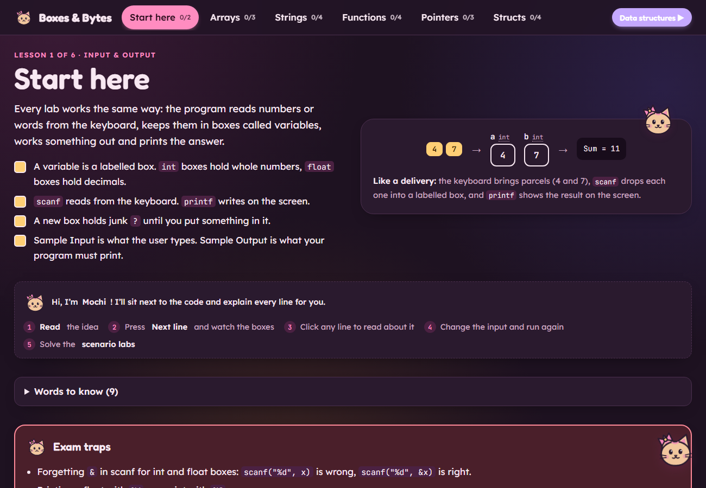 | 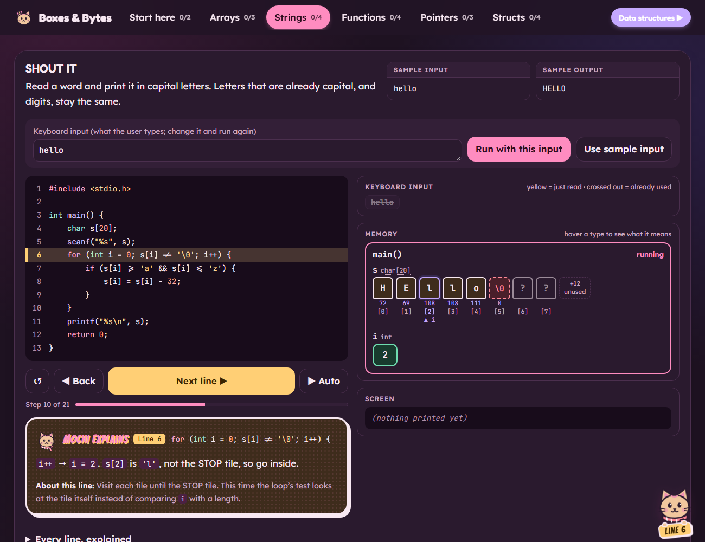 |
| **Start here**: Mochi rolls in and explains how the course works. | **Strings**: tiles show the ASCII code under every letter; `'h'` 104 − 32 becomes `'H'` 72. |
| 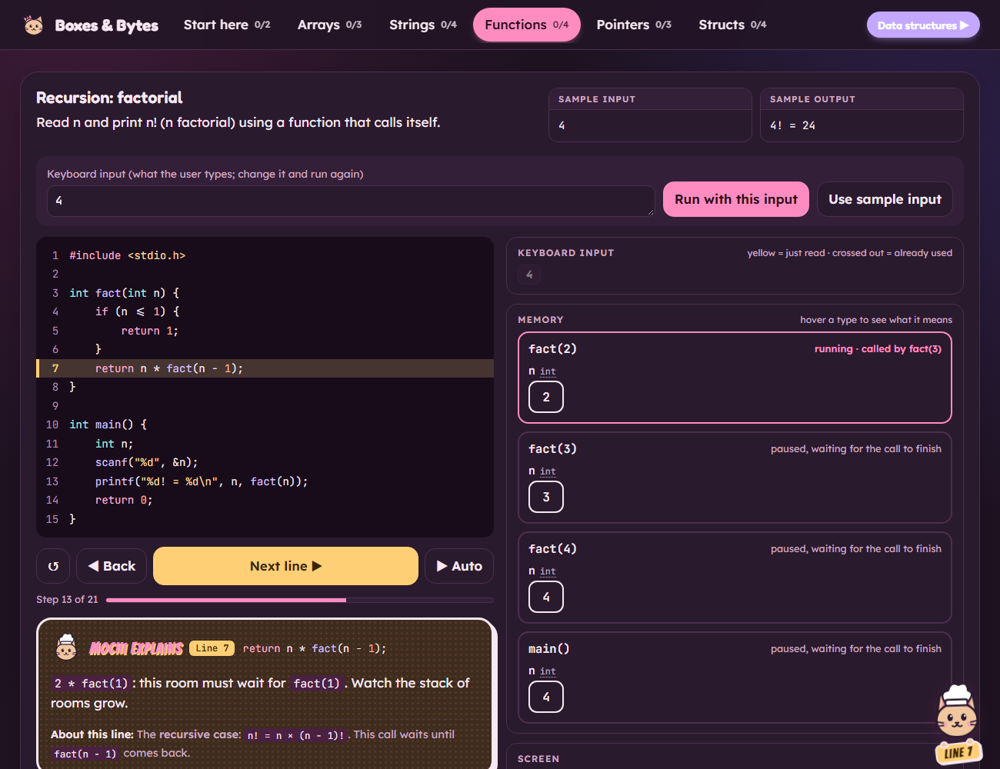 | 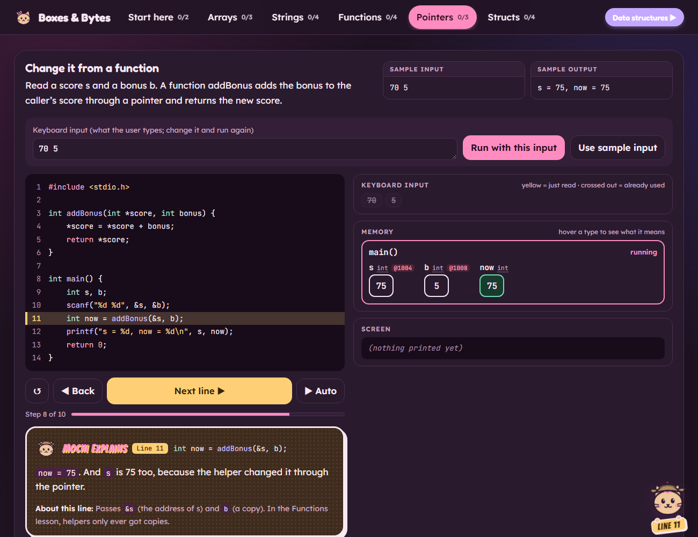 |
| **Recursion**: each `fact(n)` call gets its own room on the stack. | **Pointers**: addresses, arrows, and a helper changing `main`'s variable through `*score`. |
| 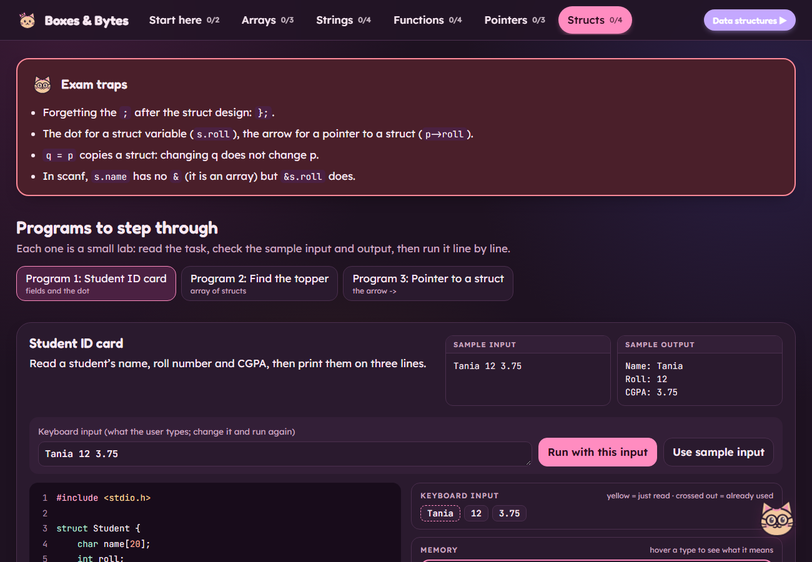 | 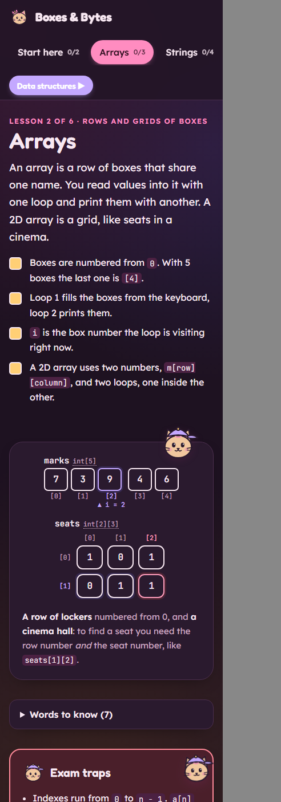 |
| **Exam traps** and scenario labs in lab format. | Works at phone width. |

## Part 2 · Frame Ops (with KESTREL) 🤖

**Data structures in C**, styled as a mobile-suit cockpit: each topic is a "sortie".

| Sortie | Theory (Intel) | Step-through programs | Field tests |
|---|---|---|---|
| 00 Memory and pointers | Stack vs heap, `malloc`/`calloc`/`realloc`/`free`, `NULL`, leaks, dangling pointers, Big-O, ADTs | Deploy one node safely | Spot the leak; use after free |
| 01 Singly linked list | Array vs linked list, list types, insert/delete/reverse storyboards, uses, pros and cons | Build with `insertEnd`, `printList`, `deleteKey` | Insert at front; length |
| 02 Doubly linked list | Singly vs doubly, the 4-pointer insert, delete, uses | Forward and backward with `head`/`tail` | Unlink a middle node; pointer walk |
| 03 Circular list | Where the last node points, tail-only lists, uses (round robin, Josephus) | Build a ring, `do-while` lap, rotate | Seven checkpoints; close the ring |
| 04 Queue | Queue ADT, stack vs queue, linear vs circular array vs linked, priority queue and deque | Linked queue (`front`/`rear`); **circular array queue** with `% N`, wrap-around and overflow | FIFO order; resetting `rear` |
| 05 Binary search tree | Terminology, tree types, formulas, all four traversals, **BST delete (3 cases)**, costs | Recursive insert, inorder, search | Preorder output; search path |

Every sortie also has pseudocode for each operation (each line explained, with its cost), exam traps, and exam theory questions with model answers.

| | |
|---|---|
| 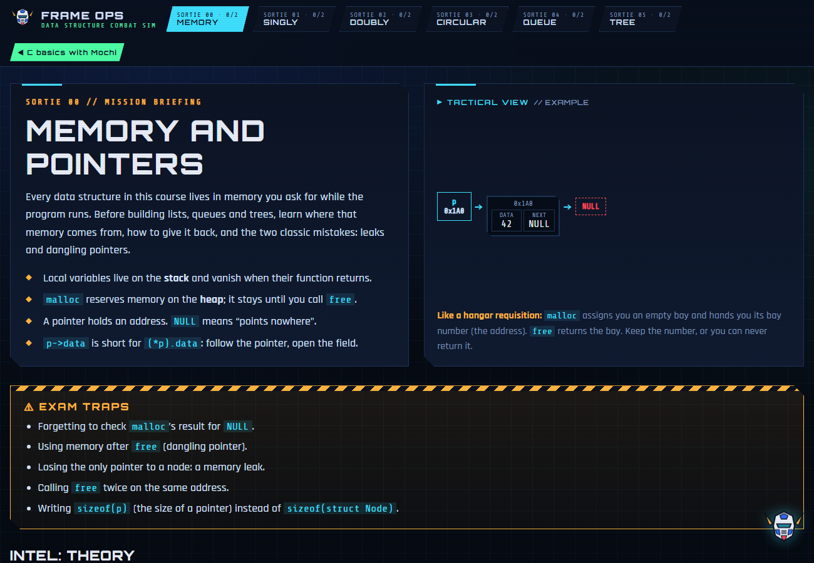 | 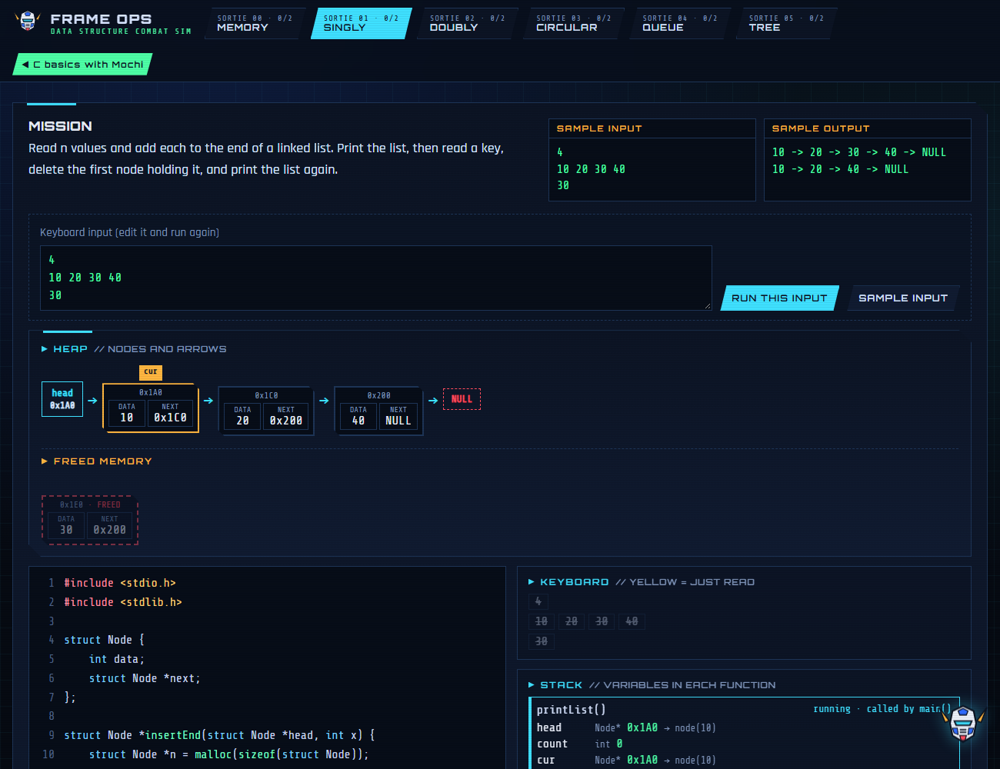 |
| **Sortie 00**: mission briefing, live diagram, exam traps. | **Singly list**: after `deleteKey(30)`, the freed node shows under *Freed memory*. |
| 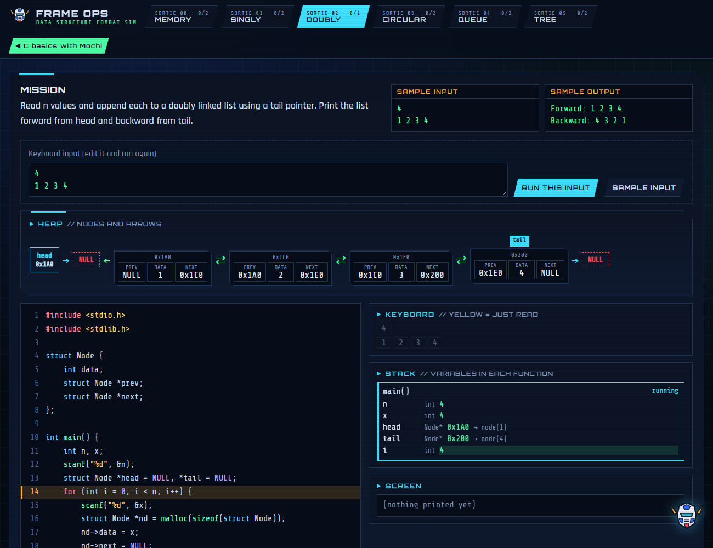 | 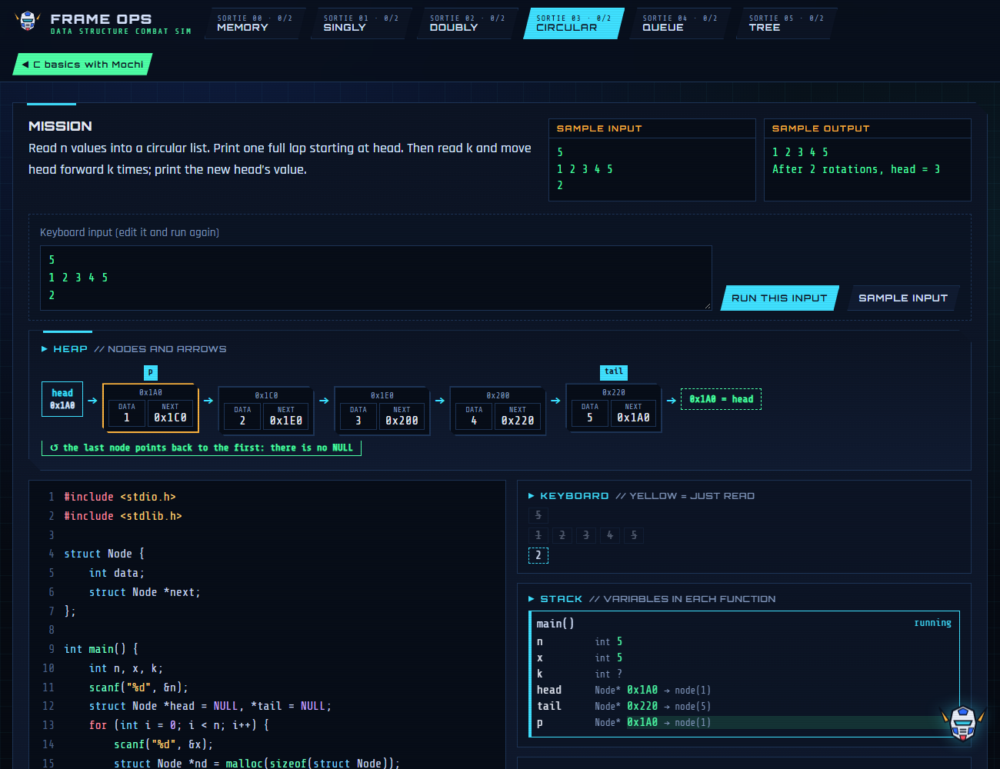 |
| **Doubly list**: two-way links ⇄ with `head` and `tail`. | **Circular list**: the last node points back to the head. |
| 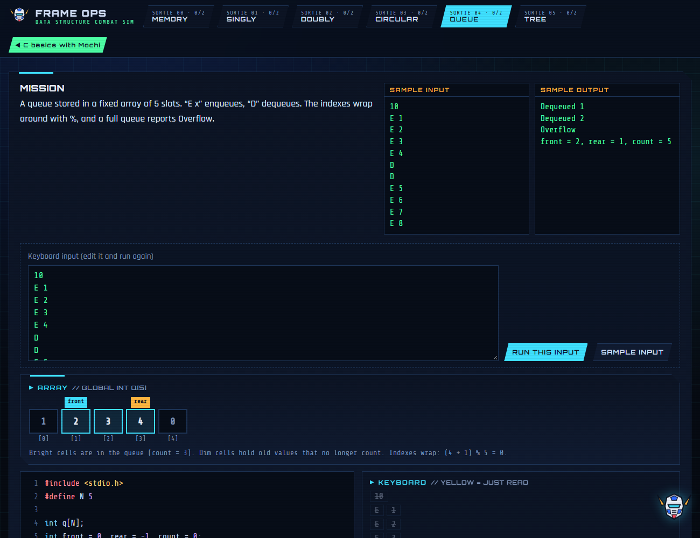 | 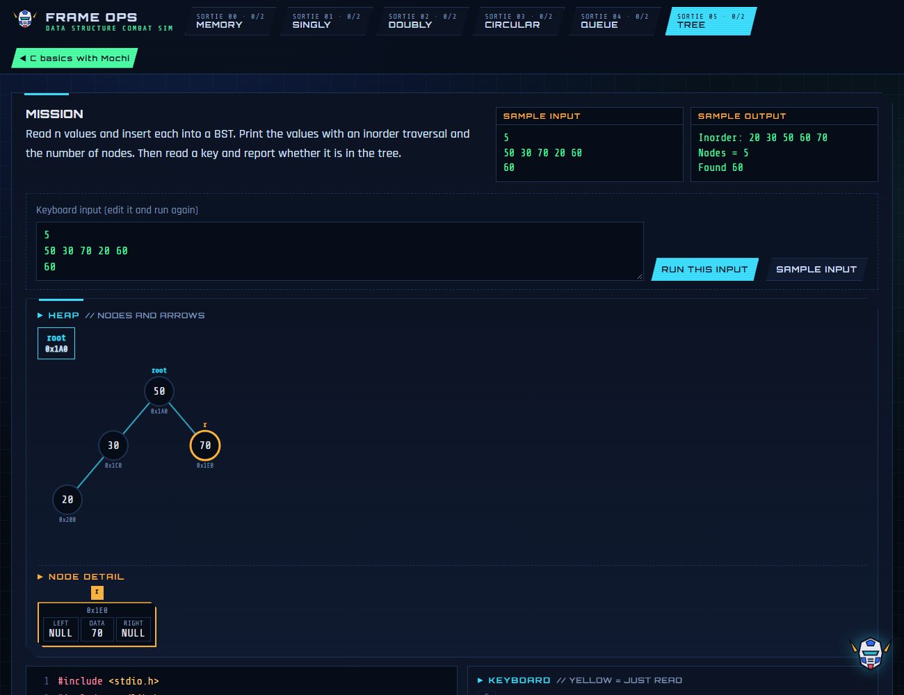 |
| **Circular array queue**: `front`/`rear` wrap around with `% N`. | **BST**: the tree is drawn live while recursive calls stack up. |
| 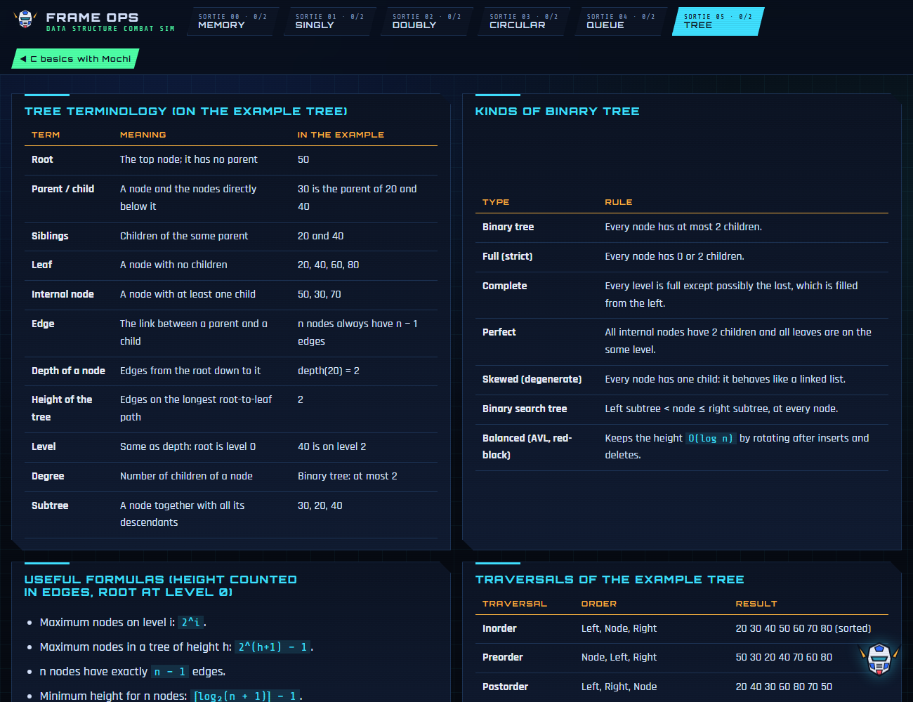 | 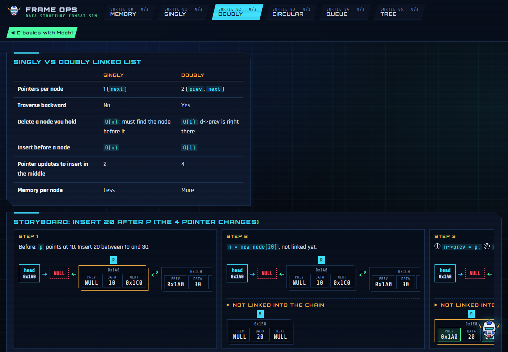 |
| **Intel**: terminology, tree types, formulas, traversals. | **Storyboards**: each pointer change shown step by step. |

---

## Course conventions

- Programs read input with `scanf` and are checked against a Sample Output, the same way our labs are marked.
- `int main()` is used everywhere, and **no function uses `void`**: every function returns a value (for example `printList` returns its count and `dequeue` returns the removed value).
- Every program and lab was run on its sample input and checked to print **exactly** its Sample Output: 607 steps in Boxes & Bytes and 1,013 steps in Frame Ops.

## How to use it

1. Open a lesson and read the idea, the analogy and the exam traps.
2. Press **Next line** (or use the → arrow key) and watch memory change. Click any line of code to read what it means. **Auto** plays the program; Frame Ops also has 1×/2×/4× speed.
3. Change the keyboard input and press **Run** to test your own cases.
4. Solve the labs, then press **Watch it run** / **Run sim** to see why the answer is right.

## Deployment

The site is deployed with **GitHub Pages** from the `main` branch, root folder:

- Part 1: https://meherabhs.github.io/boxes-and-bytes/
- Part 2: https://meherabhs.github.io/boxes-and-bytes/frame-ops.html

To update it, edit the HTML and push to `main`; Pages rebuilds in about a minute.

To run it locally, open `index.html` in a browser, or serve the folder so that the links between the two parts work:

```bash
python -m http.server 8000
# then open http://localhost:8000
```

## Project structure

```
index.html        Part 1: Boxes & Bytes (C basics with Mochi)
frame-ops.html    Part 2: Frame Ops (data structures with KESTREL)
screenshots/      Images used in this README
README.md
```

Each part is one self-contained HTML file with vanilla JavaScript and CSS: no frameworks, no build tools, no tracking. The only outside request is for Google Fonts. Lesson progress is stored only in the visitor's own browser (`localStorage`).

## A note on the characters

Mochi and KESTREL are original characters drawn for this project as inline SVG. Frame Ops borrows the general *look* of mecha-anime cockpit screens (angular HUD panels, warning stripes, a "sortie" launch). It does not use any franchise's characters, mobile suit designs, names or logos, and it is not affiliated with any of them.
